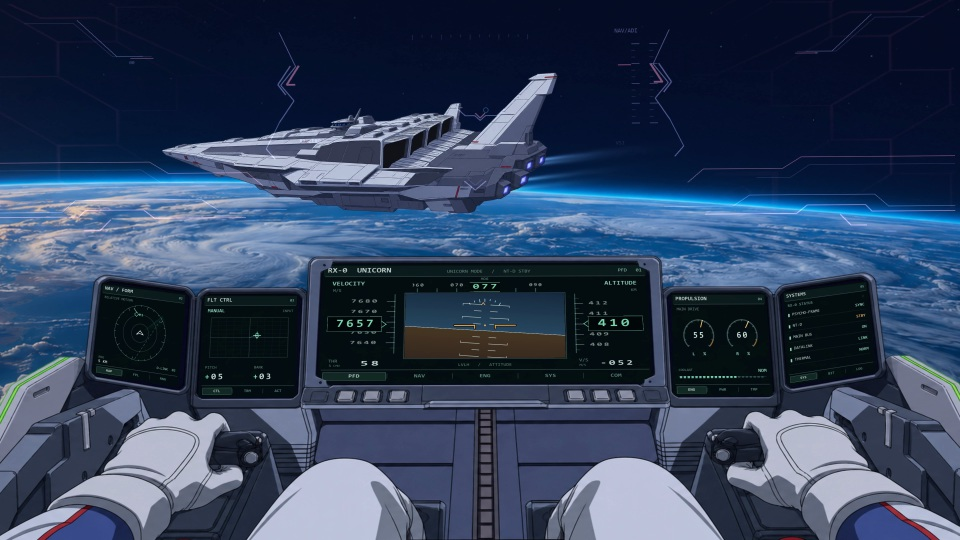

# Wallpaper for Gundam Unicorn Pilot Screen

A three-minute silent wallpaper from the pilot’s seat of the RX-0 Unicorn. A white carrier holds formation above Earth. The pilot’s hands ease the controls into a bank and the artificial horizon follows. All five cockpit monitors stay live across the loop.

**[Download the 4K60 MP4](https://github.com/JustinMars999/wallpaper-for-gundam-unicorn-pilot-screen/releases/download/v1.0.0/RX-0-Unicorn-Orbital-Formation-4K60-Silent-Loop.mp4)** · [Release and checksum](https://github.com/JustinMars999/wallpaper-for-gundam-unicorn-pilot-screen/releases/tag/v1.0.0)



## Use it in Lively Wallpaper

Download the MP4, drag it into the Lively library, then select it as your wallpaper. You can send the download or release link to anyone. Playback uses the local file and the video has no audio track. [Lively video guide](https://github.com/lively-community/lively/wiki/Video-Guide)

| Resolution | Duration | Frame rate | Video | File size |
| --- | --- | --- | --- | --- |
| 3840 × 2160 | 3 min | 60 fps, 10,800 frames | H.264 High, Rec. 709 | 715,587,025 bytes (682.4 MiB) |

## Render it yourself

The checkout contains every image and texture the final renderer reads. The tested render platform is Windows with Python 3.11, desktop OpenGL 3.3, an NVIDIA GPU with H.264 NVENC, and FFmpeg with the `h264_nvenc` encoder on your PATH. You only need these tools to build a video.

```powershell
git clone https://github.com/JustinMars999/wallpaper-for-gundam-unicorn-pilot-screen.git
cd wallpaper-for-gundam-unicorn-pilot-screen
py -3.11 -m venv .venv
.\.venv\Scripts\python.exe -m pip install -r requirements.txt
.\.venv\Scripts\python.exe src/render.py
```

The default output is `build/RX-0-Unicorn-Orbital-Formation-4K60-Silent-Loop.mp4`. For a quick look, run `src/render.py --preview` with the same Python executable. It saves eight stills from different points in the orbit. A complete command reference, the original design iterations, encoder settings and playback tests are in the [production notes](docs/production.md). The [art direction](docs/art-direction.md) explains how the three painted layers were made.

## Credits and licence

Creative direction and final selection by **JustinMars999**. AI assistance credited to **OpenAI ChatGPT / Codex, GPT-6.2 Astra**. OpenAI ImageGen generated the three background and foreground illustrations.

An unofficial fan work inspired by *Mobile Suit Gundam Unicorn*. Gundam series artwork © SOTSU・SUNRISE. With acknowledgements to Bandai, BANDAI SPIRITS, Bandai Namco Filmworks, and the two reference uploaders, Redz Schneider and DT Entertainment. The original renderer, shaders and tools are open source under **GPL-3.0-only**. Gundam designs, reference material and the finished fan-art video have separate rights. [Full credits and rights information](CREDITS.md) · [Software licence](LICENSE)
